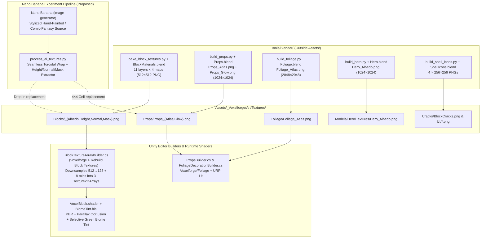

# Voxelforge — Texture Architecture Catalog & Nano Banana Experiment Guide

> [!IMPORTANT]
> **Development Snapshot Note (Captured During Phase 4.6):**
> This catalog and architecture guide was created while working on **Phase 4.6 (Class & Spell Design)**. When we begin executing this texture upgrade pass in a later phase before release, **run a fresh audit first** to include all textures added after Phase 4.6—such as class totems and spell icons (4.6), playable races & the *Thunderhoof Plains* biome (4.7), monsters, dungeon bosses, ore tiers, herbs, crafting stations, potions, and armor/weapons (Phase 5), and Title/Loading screen art (Phase 6).

> **Purpose of this document:**
> 1. **Visual Catalog:** View every texture currently used in Voxelforge directly inside your Markdown preview (`Ctrl+Shift+V` in VS Code / Cursor / Antigravity) and see how it stacks up against our [ROADMAP.md](ROADMAP.md) Style & World Guide.
> 2. **Blender & Unity Architecture Reference:** Document how each texture is generated, packed, imported, and shaded so replacements never break greedy meshing, parallax mapping, biome tinting, or UV layouts.
> 3. **Nano Banana Experimentation Game Plan:** A step-by-step workflow for generating, post-processing, and play-testing AI-assisted hand-painted & comic-fantasy texture upgrades.

---

## 1. Visual Target: Style & World Guide Summary

From [ROADMAP.md](ROADMAP.md):
- **Era & Setting (High-Fantasy Pseudo-Medieval + Magitech):** Rooted in 14th–16th century castles, knights, timber, and masonry, collided with arcane crystals, black-powder firearms, and steam/mechanical constructs (like Kian's M.G.R.S.).
- **"Chunky" Proportions:** Oversized, bold shapes and silhouettes that read unmistakably from a distance against the `1 m` voxel grid.
- **Stylized Hand-Painted & Comic Fantasy:**
  - **Painterly Brushwork:** Block faces and props should look like illustrative, hand-painted brush strokes on canvas—not mathematical Perlin/Voronoi noise clouds.
  - **High Contrast, Saturated Palette & Comic Framing:** Deep, inked crevices and bold value/hue contrast (warm sunlit highlights vs. cool, dark crevices) that match our comic-book HUD and toon-inked spell icons.

---

## 2. End-to-End Texture Pipeline Overview



---

## 3. Complete Visual Catalog & Technical Contracts

Voxelforge uses **6 distinct texture systems**. Below is every texture file in the project, its visual preview, how it works in Blender and Unity, and what needs improvement.

---

### System 1: Voxel Block Textures (`Assets/_Voxelforge/Art/Textures/Blocks/`)

- **Blender Generator:** [`Tools/Blender/bake_block_textures.py`](Tools/Blender/bake_block_textures.py) + `Tools/Blender/BlockMaterials.blend`
- **Unity Builder:** [`Assets/_Voxelforge/Scripts/Editor/BlockTextureArrayBuilder.cs`](Assets/_Voxelforge/Scripts/Editor/BlockTextureArrayBuilder.cs) (*Menu: `Voxelforge > Rebuild Block Textures`*)
- **Unity Runtime Shader:** [`Assets/_Voxelforge/Shaders/VoxelBlock.shader`](Assets/_Voxelforge/Shaders/VoxelBlock.shader) + [`Assets/_Voxelforge/Shaders/BiomeTint.hlsl`](Assets/_Voxelforge/Shaders/BiomeTint.hlsl)
- **Compiled Runtime Assets (`Assets/_Voxelforge/Art/Textures/Blocks/Arrays/`):**
  - `BlockAlbedoHeight.asset` (`Texture2DArray`, `128×128`, 8 mips, `BC7` sRGB)
  - `BlockNormal.asset` (`Texture2DArray`, `128×128`, 8 mips, `BC5` Linear)
  - `BlockMask.asset` (`Texture2DArray`, `128×128`, 8 mips, `BC7` Linear)

#### How Block Textures Work in Blender & Unity
1. **Four 512×512 PNGs per Layer:**
   - `<Layer>_Albedo.png`: Painted base color in sRGB (with light/shadow baked into bumps and crevices).
   - `<Layer>_Height.png`: Grayscale height (`0.0` = deep crevice, `1.0` = highest bump). Used at runtime for **Parallax Occlusion Mapping** (6–16 raymarch steps, `0.03` blocks deep within `32 m`).
   - `<Layer>_Normal.png`: Tangent-space normal map in OpenGL convention (`+Y` up), computed from `<Layer>_Height.png` via finite differences (`normal_from_height`). Unity packs `R` and `G` into `BC5` and reconstructs `Z` in the shader.
   - `<Layer>_Mask.png`: Channel-packed linear mask:
     - **Red (`R`)**: Ambient Occlusion derived from height crevices (`occlusion_from_height`).
     - **Green (`G`)**: Smoothness (`1.0 - roughness`). Low (`~0.1–0.2`) for matte dirt/stone, high (`~0.82`) on crystal facets and snow glints.
     - **Blue (`B`)**: Emission mask (`0.0` for normal blocks; `0.35–1.0` on glowing crystals in `ManaCrystalOre`, multiplied by `albedo * _EmissionStrength` in `VoxelBlock.shader`).
2. **Downsampling & Mip Generation (`BlockTextureArrayBuilder`):**
   - The `512×512` source PNGs are **not** shipped directly in builds; `BlockTextureArrayBuilder.Rebuild()` box-filters them in linear space down to `128×128` (`BlockTextureArrayBuilder.Size`) and builds all 8 mip levels (`128 → 1`) with re-normalized normal vectors before compressing to `BC7`/`BC5`.
   - Any replacement PNG must be **square, power-of-two, and at least `128×128`** (`512×512` recommended).
3. **Greedy Meshing & Seamless Tiling Contract:**
   - `GreedyMesher` merges adjacent identical block faces (when their 4 corner AO values match) into single large quads where `UV0` is measured in **blocks** (`1 UV unit = 1 meter block`) with `TextureWrapMode.Repeat`.
   - Therefore, **every block texture must tile seamlessly**:
     - `GrassTop`, `Dirt`, `Stone`, `ManaCrystalOre`, `Sand`, `Sandstone`, `RedRock`, `Snow`, and `LogBark` must tile seamlessly on **both X (`U`) and Y (`V`) axes**.
     - `GrassSide` must tile seamlessly **horizontally (`U`)**, while its top edge (`V = 1`) matches `GrassTop` and its bottom edge (`V = 0`) matches `Dirt`.
     - `LogTop` sits on single 1×1 end-caps (or merged log tops) with a symmetrical bark rim around all 4 edges.
4. **Selective Green Biome Tinting Contract (`BiomeTint.hlsl`):**
   - `Grass` blocks have `BiomeTint.Grass` enabled (white in Meadows, dry yellow in Desert, autumn orange in Red Crags, cool blue-green in Snowy Peaks).
   - Instead of using a separate tint mask texture, `BiomeTint.hlsl` computes:
     ```hlsl
     half BiomeTintMask(half3 albedo) {
         return smoothstep(0.0, 0.06, albedo.g - max(albedo.r, albedo.b));
     }
     ```
   - **Rule for `GrassTop` and `GrassSide`:** All grass blades/overhang pixels must have `G > max(R, B) + 0.06` so they receive biome tinting, and all dirt/pebble pixels on `GrassSide` must have `R >= G` so the soil never gets tinted green or blue!

#### Visual Catalog of All 11 Current Block Texture Layers

| Layer (Used By) | Albedo (`_Albedo.png`) | Height (`_Height.png`) | Normal (`_Normal.png`) | Mask (`_Mask.png` R=AO, G=Smooth, B=Emit) | Current Critique vs. Style Guide |
| :--- | :---: | :---: | :---: | :---: | :--- |
| **1. `GrassTop`**<br/>(`Grass` top face) | <br/>[GrassTop_Albedo.png](Assets/_Voxelforge/Art/Textures/Blocks/GrassTop_Albedo.png) |  |  |  | Distorted 4D Perlin noise looks like mossy sponge/camouflage rather than distinct, chunky hand-painted grass blades and clover tufts. |
| **2. `GrassSide`**<br/>(`Grass` side faces) | <br/>[GrassSide_Albedo.png](Assets/_Voxelforge/Art/Textures/Blocks/GrassSide_Albedo.png) |  |  |  | Pebbles are flat, geometric Voronoi circles (polka dots); grass overhang has unnatural sharp icicle spikes. Needs chunky layered turf and hand-painted stones. |
| **3. `Dirt`**<br/>(`Dirt` all faces, `Grass` bottom) | <br/>[Dirt_Albedo.png](Assets/_Voxelforge/Art/Textures/Blocks/Dirt_Albedo.png) |  |  |  | Same circular Voronoi polka-dot pebbles over blurry brown cloud noise. Needs rich, chunky soil clods, angular pebbles, and warm brushwork. |
| **4. `Stone`**<br/>(`Stone` all faces) | <br/>[Stone_Albedo.png](Assets/_Voxelforge/Art/Textures/Blocks/Stone_Albedo.png) |  |  |  | Raw Voronoi cell borders (`DISTANCE_TO_EDGE`) look like soft grey pillows/soap bubbles instead of chiselled, angular fantasy crag stone with crisp facets and inked crevices. |
| **5. `ManaCrystalOre`**<br/>(`ManaCrystalOre` all faces) | <br/>[ManaCrystalOre_Albedo.png](Assets/_Voxelforge/Art/Textures/Blocks/ManaCrystalOre_Albedo.png) |  |  |  | Fine Voronoi web clipped inside larger Voronoi blobs—doesn't read as 3D hexagonal/faceted crystals bursting out of dark stone cracks. |
| **6. `Sand`**<br/>(`Sand` all faces) | <br/>[Sand_Albedo.png](Assets/_Voxelforge/Art/Textures/Blocks/Sand_Albedo.png) |  |  |  | High-frequency Voronoi dots look like tortilla/sponge pores rather than hand-painted wind-swept golden dunes with warm highlights. |
| **7. `Sandstone`**<br/>(`Sandstone` all faces) | <br/>[Sandstone_Albedo.png](Assets/_Voxelforge/Art/Textures/Blocks/Sandstone_Albedo.png) |  |  |  | Flat horizontal color stripes with a uniform Voronoi web laid on top—cracks ignore the rock strata. Needs hand-painted sedimentary ledges and chipped desert blocks. |
| **8. `RedRock`**<br/>(`RedRock` all faces) | <br/>[RedRock_Albedo.png](Assets/_Voxelforge/Art/Textures/Blocks/RedRock_Albedo.png) |  |  |  | Same formula as `Sandstone` in terracotta red; Voronoi cell lines cross straight over horizontal bands without painterly crag structure. |
| **9. `Snow`**<br/>(`Snow` all faces) | <br/>[Snow_Albedo.png](Assets/_Voxelforge/Art/Textures/Blocks/Snow_Albedo.png) |  |  |  | Blurry blue-white Perlin clouds. Could have much clearer sculpted snow drifts, soft lavender/cerulean shadow hollows, and crisp painterly frost glints. |
| **10. `LogBark`**<br/>(`Log` side faces) | <br/>[LogBark_Albedo.png](Assets/_Voxelforge/Art/Textures/Blocks/LogBark_Albedo.png) |  |  |  | 5 thick vertical black sine bars over a Voronoi grid. Needs chunky, overlapping hand-painted fantasy tree bark plates with warm crevices. |
| **11. `LogTop`**<br/>(`Log` top & bottom faces) | <br/>[LogTop_Albedo.png](Assets/_Voxelforge/Art/Textures/Blocks/LogTop_Albedo.png) |  |  |  | Mathematical concentric rounded-square wave with noisy brown border. Needs an illustrative cut-wood cross-section with organic growth rings, radial splits, and a chunky bark rim. |

---

### System 2: Props, Tools & Weapons Atlas (`Assets/_Voxelforge/Art/Textures/Props/`)

- **Blender Generator:** [`Tools/Blender/build_props.py`](Tools/Blender/build_props.py) (`paint_atlas()`) + `Tools/Blender/Props.blend`
- **Unity Builder:** [`Assets/_Voxelforge/Scripts/Editor/PropsBuilder.cs`](Assets/_Voxelforge/Scripts/Editor/PropsBuilder.cs) (*Menu: `Voxelforge > Build Props & Items`*)
- **Materials:** `Props_World.mat` (`Voxelforge/Foliage` shader) and `Props_Held.mat` (`Universal Render Pipeline/Lit` shader)
- **Models Using This Atlas (18 FBX files in `Assets/_Voxelforge/Art/Models/Props/`):**
  - Tools & Weapons: `WoodenPickaxe`, `StonePickaxe`, `StoneAxe`, `PickOfDestiny`, `Mgrs` (Magic Gun Rifle Staff), `RuneHammer`
  - Placeable Props: `TorchFloor`, `TorchWall`, `Workbench`, `HomeTotem`, `Chest`, `ChestBody`, `ChestLid`, `TrainingDummy`
  - Bags & Loot: `BagSatchel`, `BagPack`, `BagRucksack`, `LootBag`

#### Visual Preview of Current `Props_Atlas.png` & `Props_Glow.png`

| `Props_Atlas.png` (`1024×1024` — 4×4 Grid of `256×256` Material Tiles) | `Props_Glow.png` (`1024×1024` Emission Mask) |
| :---: | :---: |
| <br/>[Props_Atlas.png](Assets/_Voxelforge/Art/Textures/Props/Props_Atlas.png) | <br/>[Props_Glow.png](Assets/_Voxelforge/Art/Textures/Props/Props_Glow.png) |

#### How the 4×4 Grid Works (`GRID` in `build_props.py`)
Every 3D part of every prop/weapon model maps its UVs into one of **16 `256×256` cells** inside `Props_Atlas.png` (inset by 4 px so neighbor cells never bleed):

| Row \ Col | Col 0 (`u: 0.00–0.25`) | Col 1 (`u: 0.25–0.50`) | Col 2 (`u: 0.50–0.75`) | Col 3 (`u: 0.75–1.00`) |
| :--- | :--- | :--- | :--- | :--- |
| **Row 0 (Top)**<br/>(`v: 0.75–1.00`) | **`wood`**<br/>Tool handles, workbench legs, dummy post | **`wood_dark`**<br/>Staff stock, chest framing, dark handles | **`planks`**<br/>Workbench top, storage chest panels | **`stone`**<br/>Stone pickaxe/axe heads, totem base |
| **Row 1**<br/>(`v: 0.50–0.75`) | **`iron`**<br/>Chest bands, brackets, rivets, kettle | **`steel`**<br/>Pick of Destiny blades, M.G.R.S. barrel, hammer | **`gold`**<br/>M.G.R.S. crown/sights, chest lock, trim | **`leather`**<br/>Grip wraps, satchel body, straps |
| **Row 2**<br/>(`v: 0.25–0.50`) | **`cloth`**<br/>Torch head wrap, bedroll straps | **`flame`** *(Emissive)*<br/>Torch flames | **`mana`** *(Emissive)*<br/>Pick of Destiny & M.G.R.S. crystals | **`rune`** *(Emissive)*<br/>Carved cyan runes on dark wood |
| **Row 3 (Bottom)**<br/>(`v: 0.00–0.25`) | **`totem`**<br/>Carved weathered wood on Home Totem | **`hearth`** *(Emissive)*<br/>Green glowing house/gem on Home Totem | **`canvas`**<br/>Loot bag, backpacks, Training Dummy body | **`rope`**<br/>Loot bag tie, dummy bindings, rope coil |

> **Why `Props_Atlas.png` is a huge high-leverage target for Nano Banana:**
> Because all 18 models simply map box/cylinder faces onto these 16 flat material squares (with `grain` aligned along `V`), replacing these `256×256` tiles with Nano Banana hand-painted wood, hammered iron, gleaming steel, ornate gold, stitched leather, woven burlap, and arcane crystals **immediately upgrades every tool, weapon, chest, backpack, and workbench in the game** without touching a single FBX mesh!

---

### System 3: Foliage & Tree Atlas (`Assets/_Voxelforge/Art/Textures/Foliage/`)

- **Blender Generator:** [`Tools/Blender/build_foliage.py`](Tools/Blender/build_foliage.py) + `Tools/Blender/Foliage.blend`
- **Unity Postprocessor & Builder:** `FoliageImportSettings.cs` + [`Assets/_Voxelforge/Scripts/Editor/FoliageDecorationBuilder.cs`](Assets/_Voxelforge/Scripts/Editor/FoliageDecorationBuilder.cs) (*Menu: `Voxelforge > Build Foliage Decorations`*)
- **Runtime Shader:** `Assets/_Voxelforge/Shaders/Foliage.shader` (alpha cutout, GPU-instanced `RenderMeshIndirect`, vertex-alpha wind sway, dithered distance fade, selective green `BiomeTint.hlsl`).

#### Visual Preview of Current `Foliage_Atlas.png` (`2048×2048`)


[Foliage_Atlas.png](Assets/_Voxelforge/Art/Textures/Foliage/Foliage_Atlas.png)

#### Layout of the 15 Regions (`REGIONS` in `build_foliage.py`)
| Row (from Top) | Regions (`u0, v0, u1, v1` with `v` up) | Type & Mesh Dependency |
| :--- | :--- | :--- |
| **Row 0 (`v: 0.75–1.00`)** | `grass_a` (`0.0–0.5`), `grass_b` (`0.5–0.75`), `twigs` (`0.75–1.0`) | **Alpha Cutout Cards** (GrassShort, GrassTall, DryShrub) — bottom edge (`v = v0`) is rooted in ground (`sway = 0`). |
| **Row 1 (`v: 0.50–0.75`)** | `flower_yellow` (`0.0–0.25`), `flower_blue` (`0.25–0.5`), `flower_red` (`0.5–0.75`), `bush_card` (`0.75–1.0`) | **Alpha Cutout Cards** (Flowers, Bush outer cards). |
| **Row 2 (`v: 0.25–0.50`)** | `leaf_card` (`0.0–0.25`), `pine_card` (`0.25–0.5`), `dry_card` (`0.5–0.75`), **`bark_pale`** (`0.75–1.0`) | 3 **Alpha Cutout Crown Cards** + 1 **Opaque Tile** (`bark_pale` for ScrubTree trunk). |
| **Row 3 (`v: 0.00–0.25`)** | **`leaf_mass`** (`0.0–0.25`), **`pine_mass`** (`0.25–0.5`), **`dry_mass`** (`0.5–0.75`), **`bark`** (`0.75–1.0`) | **4 Opaque Surface Tiles** mapped onto tree canopy blobs and Oak/Pine trunks. |

- **Upgrade Considerations:**
  - The **5 opaque regions** (`leaf_mass`, `pine_mass`, `dry_mass`, `bark`, `bark_pale`) have no alpha cutout silhouette dependencies and can be replaced directly with Nano Banana hand-painted leaf clusters and tree bark.
  - The **10 alpha-cutout card regions** work best if kept on transparent backgrounds with stems anchored at the bottom of their cell (`v = v0`) and green leaves satisfying `G > max(R, B) + 0.06` (while flower petals stay non-green so `BiomeTint.hlsl` doesn't tint petals).

---

### System 4: Hero Character Texture (`Assets/_Voxelforge/Art/Models/Hero/Textures/`)

- **Blender Generator:** [`Tools/Blender/build_hero.py`](Tools/Blender/build_hero.py) (`bake_hero()`) + `Tools/Blender/Hero.blend`
- **Unity Builder:** `HeroAnimatorBuilder.cs` (*Menu: `Voxelforge > Rebuild Hero Animator`*)

| `Hero_Albedo.png` (`1024×1024`) | How It Works |
| :---: | :--- |
| <br/>[Hero_Albedo.png](Assets/_Voxelforge/Art/Models/Hero/Textures/Hero_Albedo.png) | Baked via Cycles `EMIT` across ~60 smart-UV-projected body parts (`skin`, `hair`, `eye`, `leather`, `leather_dark`, `pants`, `metal`, `gold`, `cloth`, `cloth_trim`). Because the UVs are an automatic island pack of 3D geometry, flat 2D AI generation cannot replace `Hero_Albedo.png` directly without 3D projection or triplanar shader mapping inside `Hero.blend`. |

---

### System 5: Block Mining Cracks (`Assets/_Voxelforge/Art/Textures/Cracks/`)

- **Unity Builder:** `BlockCrackTextureBuilder.cs` (*Menu: `Voxelforge > Rebuild Crack Textures`*)
- **Runtime Shader:** `Voxelforge/Block Crack` (multiply blend over damaged blocks across 8 stages)


[BlockCracks.png](Assets/_Voxelforge/Art/Textures/Cracks/BlockCracks.png)

---

### System 6: Comic-Book HUD & Spell Icons (`Assets/_Voxelforge/Art/Textures/UI/`)

- **Generators:**
  - UI Frames: [`Assets/_Voxelforge/Scripts/Editor/HudArtBuilder.cs`](Assets/_Voxelforge/Scripts/Editor/HudArtBuilder.cs) (*Menu: `Voxelforge > Build HUD Art`*)
  - Spell Icons: [`Tools/Blender/build_spell_icons.py`](Tools/Blender/build_spell_icons.py) (`256×256` PNGs hooked up by *`Voxelforge > Build Abilities`*)

| `ManaBolt.png` | `ArcaneOrb.png` | `Pyroblast.png` | `EarthShatter.png` | `HudPanel.png` | `HudSlotFrame.png` |
| :---: | :---: | :---: | :---: | :---: | :---: |
|  |  |  |  |  |  |

---

## 4. Game Plan for Experimenting with Nano Banana Texture Upgrades

To make sure our experiments are **fast, reversible, and 100% compatible with Unity's shaders**, we will follow a 4-stage plan backed by a small Python post-processing script.

### Step 0: Safety Backup & Post-Processing Script (`Tools/Blender/process_ai_textures.py`)
Before overwriting any PNGs in `Assets/_Voxelforge/Art/Textures/`, we will:
1. **Backup Current Procedural Textures:** Copy the existing `Blocks/*.png` and `Props/*.png` into `Tools/Blender/ProceduralBackup/` so we can revert any single layer or compare before/after at any time.
2. **Create `Tools/Blender/process_ai_textures.py`:** Because Nano Banana outputs a single RGB image that may have subtle edge discontinuities, this script will automatically:
   - **Enforce Seamless Tiling:** Apply a cosine-windowed toroidal cross-blend (or symmetry/offset synthesis) at the image borders so left/right (`U`) and top/bottom (`V`) edges match pixel-for-pixel with zero visible grid seams on greedy-meshed cliffs.
   - **Composite `GrassSide` Cleanly:** Combine the new `GrassTop` (along the top overhang with chunky, hand-painted turf tufts + inked drop shadow) over the new `Dirt` texture, while clamping green dominance (`G > max(R, B)`) strictly to the grass lip so `BiomeTint.hlsl` only tints the grass.
   - **Derive PBR Maps (`_Height.png`, `_Normal.png`, `_Mask.png`) at `512×512`:**
     - Extract a stylized height map from luminance + dark-crevice inversion (so dark comic ink lines and mortar cracks become deep `0.0` grooves and bright stone/pebble faces become raised `1.0` plateaus for Parallax Occlusion Mapping).
     - Run the exact same `normal_from_height` (OpenGL `+Y`) and `occlusion_from_height` math used by `bake_block_textures.py` so lighting and SSAO stay consistent.
     - For `ManaCrystalOre`, detect the purple/cyan crystal hue to generate high smoothness (`0.82`) and bright emission (`Mask.B`) solely on the crystal shards.

---

### Stage 1: Core Meadows & Cave Blocks Pilot (`Stone`, `Dirt`, `GrassTop`, `GrassSide`, `ManaCrystalOre`)
Our highest-impact first test covers the blocks you see immediately upon spawning in Meadows and digging into a cave:

1. **Prompting Formula for Nano Banana (`image-generator`):**
   - **Shared Style Prefix:**
     > *"Orthographic flat top-down seamless tileable game texture, stylized hand-painted Warcraft and comic-book fantasy art style, chunky exaggerated shapes, bold dark inked crevices, expressive visible brushwork, vibrant saturated colors, evenly lit diffuse albedo with painted ambient occlusion, no perspective angle, no text or borders."*
   - **Per-Block Prompts:**
     - **`Stone`:** *"Chunky interlocking fantasy crag stones and rough-hewn grey-blue rock plates with deep dark inked crevices, warm weathered mineral highlights, and painterly chisel planes."*
     - **`Dirt`:** *"Rich warm earthy brown soil with chunky angular hand-painted pebbles, small clay clods, and dark inked crevices."*
     - **`GrassTop`:** *"Lush emerald and sunlit lime-green fantasy meadow grass seen straight from above, painted in chunky swirling brush-stroke tufts and clover patches with deep forest-green crevices."*
     - **`ManaCrystalOre`:** *"Chunky grey-blue cavern rock cracked open by clusters of jagged, faceted glowing violet-and-cyan arcane mana crystals bursting from the seams, bold comic ink outlines around crystal sockets."*
2. **Post-Process & Synthesize `GrassSide`:**
   - Run `process_ai_textures.py` on the generated images to write `<Layer>_{Albedo,Height,Normal,Mask}.png` at `512×512` into `Assets/_Voxelforge/Art/Textures/Blocks/`.
3. **Rebuild & Play-Test in Unity:**
   - Run **Voxelforge → Rebuild Block Textures** in Unity (`BlockTextureArrayBuilder.Rebuild()`).
   - Check in the Scene/Game view:
     - [ ] Do greedy-meshed hills and cave walls tile smoothly without harsh grid repetition?
     - [ ] Does Parallax Occlusion Mapping (`_ParallaxDepth = 0.03`) give close-up depth on stone and crystals without swimming artifacts?
     - [ ] Does `GrassSide` tint only on the green overhang across Meadows, Red Crags, Desert, and Snowy borders?
     - [ ] Does `ManaCrystalOre` glow cleanly with Scene Bloom?

---

### Stage 2: Remaining Biome & Wood Blocks (`Sand`, `Sandstone`, `RedRock`, `Snow`, `LogBark`, `LogTop`)
Once Stage 1 looks great in-game, expand to the other 3 biomes and tree logs:
- [ ] **`Sand`:** Hand-painted golden desert sand with soft wind-swept ripples and warm amber shadow troughs (replacing the porous dots).
- [ ] **`Sandstone`:** Chiseled desert canyon rock strata in warm ochre and tan with hand-painted horizontal ledges and vertical fractures.
- [ ] **`RedRock`:** Bold crimson-terracotta Redridge crag rock with stepped painted plates and deep dark-red inked crevices.
- [ ] **`Snow`:** Sculpted alpine snow drifts with soft cerulean/lavender shadows and crisp white highlight brushstrokes.
- [ ] **`LogBark`:** Chunky, overlapping fantasy oak bark plates with deep vertical inked grooves and warm russet highlights.
- [ ] **`LogTop`:** Hand-painted cut log end-cap with organic warm heartwood rings, radial wood splits, and a chunky outer bark rim.

---

### Stage 3: The 16-Tile `Props_Atlas.png` Overhaul
Upgrade the `4×4` material grid in `Assets/_Voxelforge/Art/Textures/Props/Props_Atlas.png` (and `Props_Glow.png`):
- [ ] Generate hand-painted comic-fantasy material tiles for:
  - **Woods:** `wood`, `wood_dark`, `planks`, `totem`
  - **Metals & Stone:** `stone`, `iron` (hammered dark forged iron), `steel` (bright painted blade steel with bevel highlights), `gold` (warm ornate fantasy brass/gold)
  - **Fabrics & Organics:** `leather` (stitched warm saddle leather), `cloth`, `canvas` (chunky woven burlap), `rope` (thick twisted hemp rope)
  - **Emissives:** `flame` (stylized comic fire gradient), `mana` (faceted arcane crystal surface), `rune` (glowing cyan runes carved in dark timber), `hearth` (emerald hearth-magic glow)
- [ ] Composite into the `1024×1024` `Props_Atlas.png` + `Props_Glow.png` (preserving the exact `GRID` UV coordinates in `build_props.py`).
- [ ] Verify held tools (`PickOfDestiny`, `Mgrs`, `RuneHammer`) and placed props (`Workbench`, `HomeTotem`, `Chest`, `TrainingDummy`, `Bag*`) in Unity.

---

### Stage 4: Foliage Canopy/Bark Tiles & Spell Icons (Optional Polish)
- [ ] Replace the 5 opaque regions in `Foliage_Atlas.png` (`leaf_mass`, `pine_mass`, `dry_mass`, `bark`, `bark_pale`) with richer hand-painted foliage clusters and bark.
- [ ] Experiment with Nano Banana comic-book illustrations for the action bar spell icons in `Assets/_Voxelforge/Art/Textures/UI/Icons/`.

